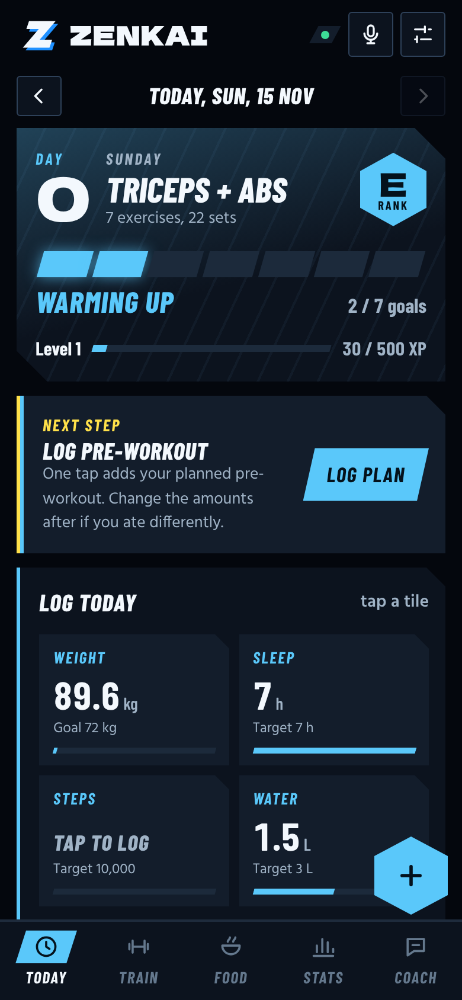
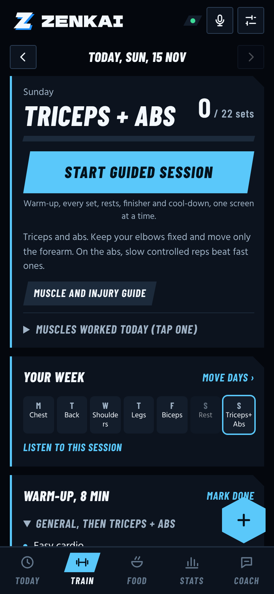
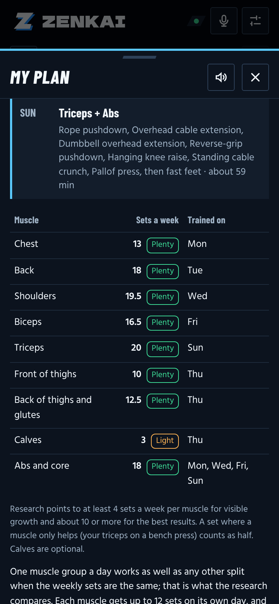
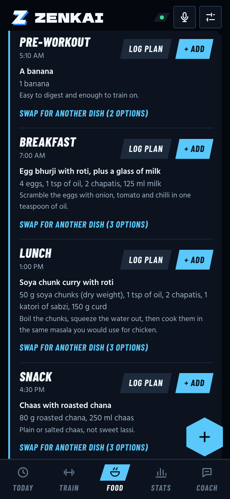
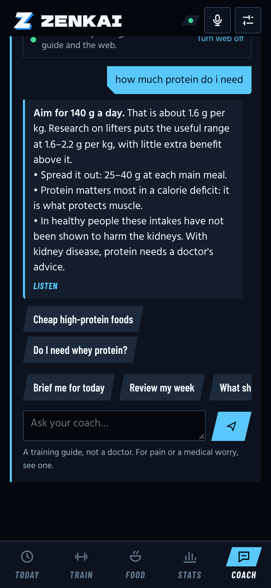
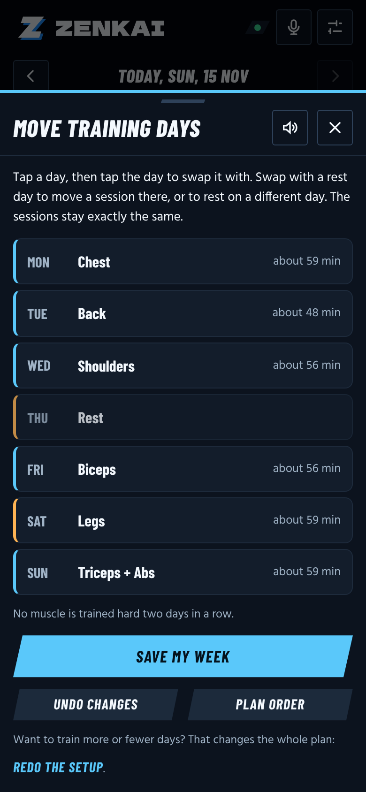

# ZENKAI

**A personal training, food and progress tracker for Android that builds a complete plan around the
person using it, and coaches them through it.**


Answer a few questions about your body, goal, week and food, and ZENKAI builds your calorie and protein
targets, a training week, a day of Indian meals that fits your budget, and a daily routine. Then it helps
you follow it: a guided workout player with form photos and videos, a food log you fill by typing what you
ate, progress charts, reminders, a coach you can ask anything, and voice control.

No account, no API key, no ads. Your log stays on your phone.

Zenkai (全開) is Japanese for *full throttle*.

Designed and built by **Atharva Sail**.

---

## Screenshots

| Today | Train | My plan |
|---|---|---|
|  |  |  |

| Food | Coach | Move training days |
|---|---|---|
|  |  |  |

---

## Features

### A plan built for you
- **13-step setup**: body, goal (lose fat, build muscle, tone up, stay fit, get stronger), target weight and
  pace, daily activity, training experience, equipment (gym, dumbbells, none), days and session length,
  preferred split, focus areas, diet, kind of Indian food you eat, the foods you actually eat, monthly
  budget, daily routine and a health check.
- **Targets with the working shown**: Mifflin–St Jeor energy estimate, a safe calorie gap or surplus,
  protein by body weight, fat, carbs, fibre, water, steps and sleep.
- **Built-in safety limits**: calories never below 1,200 (women) or 1,500 (men), a cut never more than a
  quarter of daily burn, no cut for under-18s, maintenance only during pregnancy or with an eating-disorder
  history, and a doctor note for any health flag.

### Training
- **Every split you might want**: full body, upper/lower, push/pull/legs, two muscle groups a day, one muscle
  group a day (chest, back, shoulders, legs, biceps, triceps + abs), or let the app choose.
- **Every muscle counted**: whatever the split, the builder counts weekly sets for every muscle and adds or
  swaps exercises until each gets at least 4 sets, with direct biceps, triceps and abs work.
- **70 exercises** with photos, set-up, numbered steps, breathing cues, common mistakes and alternatives.
- **Guided session player**: timed warm-up, every set with weight and rep steppers, automatic rests,
  finisher and cool-down, one screen at a time, with spoken cues.
- **Move training days** (legs from Thursday to Saturday, rest on Wednesday instead of Sunday). Sessions
  stay the same, and the app warns when a muscle would be trained hard two days in a row.
- **Swap an exercise** when a machine is busy, for today or for good.
- **Learning weeks** for beginners: two sets of everything for the first two weeks.

### Food
- **Meals from the foods you eat**, for North, South, West or East Indian food, a mix, or non-Indian food.
  Each meal offers two or three dishes with similar calories and protein.
- **Budget aware**: dishes are ranked by cost and the menu is kept inside the monthly budget you pick.
- **"How to eat" guide**: the plate, protein per meal, the cheapest protein you eat with prices, portions
  without a scale, sugar, salt and oil limits, cravings, and tips for home, mess or restaurant food.
- **Type what you ate** ("2 aloo paratha with dahi and a cup of chai") and check the matches before they
  are logged. 148 Indian foods built in, plus packaged foods from Open Food Facts.

### Coach and voice
- **Coach**: answers from your own log, a built-in knowledge base of about 40 topics, and live lookups on
  Wikipedia, MedlinePlus and Open Food Facts, with the source shown. Understands spelling slips and common
  Hinglish.
- **Voice**: tap the microphone and say "read my day", "my weight is 88.4", "I drank 2 glasses of water",
  "I ate 2 eggs and 2 chapatis", "start my workout", "move legs to Saturday", or any question.
  A speaker button reads any screen aloud. Name your assistant whatever you like.

### Progress
- Weekly-average weight trend, real calorie burn measured from your log, body fat from tape measurements,
  readiness score, personal bests, weekly review, badges, reminders, app-icon shortcuts, backup and CSV export.

---

## Install

Download `ZENKAI.apk` from the [Releases](../../releases) page, open it on the phone and allow the install.
Play Protect may say it does not recognise the developer; choose *Install anyway*.

Installing a newer version over an older one keeps the log, as long as both were signed with the same key.

| Permission | Why |
|---|---|
| Internet | Coach web lookups, packaged-food search, form videos. Nothing from the log is sent |
| Notifications | Reminders (Android 13+ asks the first time one is switched on) |
| Run at startup | Re-arms reminders after a restart |
| Vibrate | Rest-timer buzz |

Voice uses the phone's own text-to-speech engine and voice-input app, so no microphone permission is
requested by ZENKAI itself.

---

## Run it in a browser

The whole app is a static web page, so you can try it on a computer without Android:

```bash
npm run serve        # or: python3 -m http.server 8080 --directory app/src/main/assets/www
```

Then open <http://localhost:8080>. Reminders, MedlinePlus lookups and the phone's voice input need the Android app;
reading aloud and voice input work in browsers that support the Web Speech API (Chrome, Edge).

---

## Build the APK

### With `build.sh` (no Gradle)

Needs a JDK 17+ and four files in `./tools`:

| File | Where to get it |
|---|---|
| `android.jar` | Android SDK, `platforms/android-34/android.jar` |
| `aapt2` | Android SDK build-tools |
| `d8.jar` | Android SDK build-tools `lib/d8.jar` |
| `uber-apk-signer.jar` | <https://github.com/patrickfav/uber-apk-signer/releases> |

```bash
cp keystore.properties.example keystore.properties   # then point it at your key
./build.sh                                            # writes ZENKAI.apk
```

Without `keystore.properties`, `build.sh` creates a new key in `keystore/` on the first build.

### With Android Studio

Open the folder as a project. The Gradle build reads the same `keystore.properties`; without it, release
builds use the debug key. If Android Studio asks to update the Android Gradle Plugin, let it.

### Signing

Android only installs an update over an existing app when both are signed with the same key. Keep your
keystore and its passwords private and backed up. `keystore/` and `keystore.properties` are in
`.gitignore` and must never be committed.

---

## How it works

ZENKAI is a single-page web app inside a thin Android shell.

```
┌────────────────────────── Android (Java) ──────────────────────────┐
│  MainActivity   one WebView, serves the assets at a fixed https    │
│                 origin, native bridge window.SZNative               │
│  Remind, AlarmReceiver, BootReceiver   daily reminders              │
│  Voice, VoiceDone                      text-to-speech               │
└─────────────────────────────────┬──────────────────────────────────┘
                                  │
┌─────────────────────── Web app (vanilla JS) ───────────────────────┐
│  data.js   exercises, foods, plans, sources        → window.SZD     │
│  learn.js  muscles, injury rules                   → adds to SZD    │
│  plan.js   setup answers → targets, week, meals    → window.SZP     │
│  core.js   log, storage, derived numbers           → window.SZ      │
│  coach.js  rule-based coach + web lookups          → window.SZCoach │
│  voice.js  read aloud, voice input                 → window.SZVoice │
│  ui.js     screens, sheets, workout player, actions                 │
└─────────────────────────────────────────────────────────────────────┘
```

- **No frameworks, no build step** for the web app: plain ES5-style modules loaded in order by `index.html`.
- **Storage**: one JSON object in `localStorage`, validated and migrated on every load.
- **Plans are pure functions**: `SZP.build(answers)` returns targets, the week, meals, routine, reminders
  and the research notes. Nothing in `plan.js` touches the log.
- **UI wiring**: every button has `data-act="name"` handled by `ACT[name]` in `ui.js`; every input has
  `data-chg="name"` handled by `CHG[name]`.
- **Network**: the shell only fetches from `en.wikipedia.org`, `wsearch.nlm.nih.gov` and
  `world.openfoodfacts.org` over HTTPS (`NET_HOSTS` in `MainActivity.java`). Only the key words of a
  question are sent.

### Native bridge (`window.SZNative`)

| Method | Purpose |
|---|---|
| `saveFile`, `saveFileAs` | Save a backup or CSV through the system file picker |
| `setReminders`, `canNotify`, `askNotify`, `testNotify` | Reminders |
| `httpGet(id, url)` | HTTPS GET to an allowed host; reply in `window.SZ_http` |
| `speak`, `stopSpeaking` | Text-to-speech; progress in `window.SZ_voice` |
| `canListen`, `listen` | Voice input; words in `window.SZ_heard` |
| `copy`, `vibrate`, `keepAwake`, `setBars`, `launchTarget`, `version` | Small helpers |

---

## Project structure

```
.
├── app/
│   ├── build.gradle
│   └── src/main/
│       ├── AndroidManifest.xml
│       ├── java/app/systemzero/      Android shell (Java 8, no libraries)
│       ├── res/                      icon, theme, strings, app shortcuts
│       └── assets/www/               the app itself
│           ├── index.html
│           ├── css/app.css
│           ├── js/                   data, learn, plan, core, coach, voice, ui
│           ├── fonts/
│           └── img/ex/               exercise photos (WebP)
├── tests/                            plan builder and coach checks
├── docs/screenshots/
├── build.sh                          APK build without Gradle
├── keystore.properties.example
├── CHANGELOG.md
└── LICENSE
```

The package id is `app.systemzero`, from the app's working name. It stays the same so updates install
over earlier versions.

---

## Development

```bash
npm install          # only installs Prettier
npm test             # plan builder check (5,400 profiles) and coach check
npm run format       # format JS, CSS and HTML
```

`tests/plan-check.js` builds a plan for every combination of split, goal, equipment, experience, session
length and day count, and checks that sessions fit their time, no exercise needs missing equipment,
"one muscle a day" never repeats a day, biceps, triceps and abs always get direct work, every major
muscle reaches the weekly minimum, and menus respect the diet and the calorie target.
GitHub Actions runs the same checks on every push.

---

## The research behind the numbers

Every rule in a plan is tied to a published source, and the app shows them (Menu → Sources and credits,
and *Why this plan* on the plan screen). The main ones:

- American College of Sports Medicine, resistance training position stand (2026)
- Ramos-Campo et al. 2024: split and full-body routines give the same results at equal weekly volume
- Pelland et al. 2026: weekly sets per muscle and muscle growth (dose-response)
- Behm et al. 2024: minimal effective training for beginners
- Singer et al. 2024: rest between sets
- Schoenfeld & Aragon 2018: protein per meal; ISSN 2017: protein for people who train
- ICMR-National Institute of Nutrition: Dietary Guidelines for Indians (2024), RDAs for Indians (2020)
- World Health Organization: physical activity guidelines (2020), alcohol statement (2023)
- Nedeltcheva et al. 2010: sleep and fat loss; Drake et al. 2013: caffeine and sleep

---

## Credits and licences

- **Exercise photos**: [Free Exercise DB](https://github.com/yuhonas/free-exercise-db) by yuhonas, public
  domain (Unlicense).
- **Fonts**: Barlow Condensed (Jeremy Tribby), Dela Gothic One (artakana), Hind (Indian Type Foundry), all
  under the SIL Open Font License.
- **Form videos**: played from YouTube (`youtube-nocookie.com`) when tapped; each belongs to its uploader
  and the app keeps no copy.
- **Coach lookups**: Wikipedia (text under CC BY-SA 4.0, quoted with a link), MedlinePlus from the U.S.
  National Library of Medicine (which does not endorse this app), Open Food Facts (Open Database License).
- **Food values** are estimates from standard food tables, not lab measurements.

The app's own code is released under the [MIT License](LICENSE).

---

## Health note

ZENKAI gives general fitness and nutrition guidance, not medical advice. It cannot examine you. Add load
gradually, and for sharp pain, swelling, a joint that gives way, numbness or tingling, stop and see a
doctor or physiotherapist. With a medical condition, pregnancy or a history of disordered eating, talk to
a doctor before changing how you eat or train.

---

## Author

**Atharva Sail**

See [CHANGELOG.md](CHANGELOG.md) for the history of the app.
